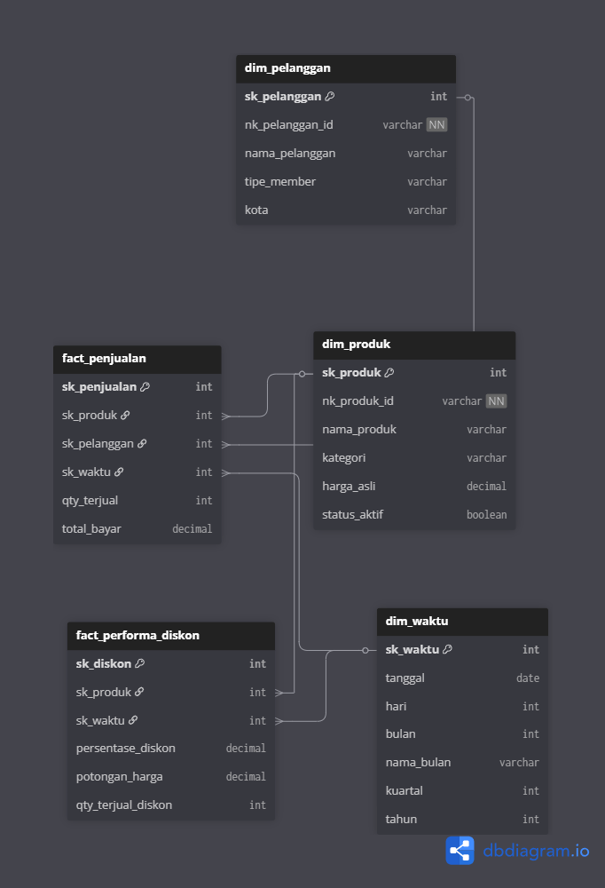

# 🛒 E-Commerce Data Warehouse & ETL Pipeline

Proyek ini membangun Data Warehouse (DWH) dengan pendekatan Star Schema menggunakan dataset E-Commerce dari Kaggle. Proses ETL (Extract, Transform, Load) diimplementasikan sepenuhnya menggunakan Python untuk membersihkan data, menyimulasikan transaksi harian, dan memuatnya ke dalam database.

## ⚠️ Disclaimer Dataset & Strategi (Penting!)

Dataset utama (Produk) yang digunakan dalam proyek ini bersumber dari:
🔗 **[Kaggle: E-Commerce Data (SHEIN)](https://www.kaggle.com/datasets/oleksiimartusiuk/e-commerce-data-shein/data)**


**Catatan Karakteristik Data & Pendekatan Tim:**
1. **Unstructured Raw Data:** Dataset asli sangat kotor. ID produk tidak tersedia secara eksplisit (harus diekstrak via Regex dari URL), harga masih berupa teks string (contoh: `$12.50`), dan kategori bergantung pada nama file CSV. Ini menjadi fokus utama teknik *Data Cleansing* kami.
2. **Hybrid Dataset Strategy:** Dataset Kaggle pada dasarnya adalah *Master Data Katalog*. Untuk memenuhi syarat arsitektur DWH (Tabel Fakta & Dimensi), data pelanggan demografis dan kejadian transaksi di-*generate* secara sintetis (Dummy Data) menggunakan skrip Python. Data dummy tersebut direlasikan secara utuh ke ID Produk riil hasil ekstraksi dari Kaggle.

## 🏗️ Arsitektur Data Warehouse (Star Schema)

Sistem Data Warehouse ini dirancang untuk menjawab 3 pertanyaan analitik utama:
1.  **Tren Penjualan & Pendapatan:** Tren penjualan harian serta total pendapatan per kategori produk.
2.  **Efektivitas Diskon:** Performa diskon produk dan dampaknya terhadap kuantitas barang terjual (*qty*).
3.  **Profil Pelanggan:** Profil pelanggan (berdasarkan tipe *membership*) dengan nilai transaksi tertinggi.

Untuk mengoptimalkan kueri analitis, arsitektur ini menggunakan **Star Schema** yang terdiri dari:
*   **3 Tabel Dimensi:** `dim_produk`, `dim_pelanggan`, `dim_waktu`
*   **2 Tabel Fakta:** `fact_penjualan`, `fact_performa_diskon`

Setiap tabel dimensi terhubung ke tabel fakta menggunakan *Surrogate Key* (SK) berbentuk integer unik.

### Entity Relationship Diagram (ERD)
*(Visualisasi skema secara utuh dapat diakses melalui gambar di bawah ini)*


## 👥 Tim & Pembagian Tugas

*   **Anggota 1: Muhammad Izzanurdin Hasan_2505551075** - *Data Architect*
    *   Fokus Area: Folder `/sql/`
    *   Tugas: Mendesain Star Schema dan membuat script DDL database.
*   **Anggota 2: Christopher** - *Cleansing Specialist*
    *   Fokus Area: Folder `/notebooks/` & `src/cleanse_data.py`
    *   Tugas: Data profiling dan implementasi 3 teknik cleansing (Handle Null, Duplicates, Bad Logic).
*   **Anggota 3: Mul** - *Pipeline Engineer*
    *   Fokus Area: Folder `/src/`
    *   Tugas: Membuat generator data dummy transaksi dan merangkai alur Extract & Load ke DWH.

## 🗂️ Struktur Folder

```text
ecommerce-dwh-etl/
├── data/                  # Tidak masuk GitHub (berisi raw/, interim/, processed/)
├── notebooks/             # Eksplorasi data & profiling (.ipynb)
├── src/                   # Source code ETL Python
│   ├── generate_dummy.py
│   ├── cleanse_data.py
│   └── run_etl.py
├── sql/                   # DDL Database
├── .gitignore
├── requirements.txt
└── README.md
```

## 🚀 Panduan Setup Lokal

1. **Clone Repository**
   ```bash
   git clone https://github.com/Izzanurdin/ecommerce-dwh-etl.git
   cd ecommerce-dwh-etl
   ```

2. **Buat & Aktifkan Virtual Environment**
   ```bash
   python -m venv env
   # Windows:
   env\Scripts\activate
   # Mac/Linux:
   source env/bin/activate
   ```

3. **Install Dependencies**
   ```bash
   pip install -r requirements.txt
   ```

4. **Siapkan Data Raw**
   * Buat folder `data/raw/` di root direktori proyek Anda.
   * Download dataset CSV dari Kaggle dan letakkan di dalam folder tersebut.

## 🌿 Aturan Git Branching

Untuk menghindari *conflict* saat kolaborasi, gunakan alur berikut:
1. Pastikan Anda berada di branch terbaru: `git pull origin main`
2. Buat branch baru sesuai tugas:
   * Data Architect: `git checkout -b feature/schema-design`
   * Cleansing: `git checkout -b feature/data-cleansing`
   * Pipeline: `git checkout -b feature/etl-pipeline`
3. Setelah selesai, lakukan push: `git push origin feature/[nama-branch-anda]`
4. Buka **Pull Request (PR)** di GitHub untuk di-review dan di-merge ke `main`.

### 📊 Tracker Progres Pekerjaan

Berikut adalah daftar tugas untuk setiap peran. Beri tanda centang (`[x]`) pada GitHub jika tugas telah diselesaikan.

| Peran | Tugas / Jobdesc | Status | Target Branch |
| :--- | :--- | :---: | :--- |
| **Data Architect**<br>*(Anggota 1 / Izza)* | 1. Merancang Star Schema (3 Dimensi, 2 Fakta). | [ ] | `feature/schema-design` |
| | 2. Membuat ERD dan script DBML (`/sql/dbml_star_schema.dbml`). | [ ] | `feature/schema-design` |
| | 3. Membuat script DDL (`/sql/ddl_star_schema.sql`). | [ ] | `feature/schema-design` |
| | 4. Melakukan setup Database lokal (MySQL/PostgreSQL). | [ ] | - |
| **Cleansing Specialist**<br>*(Anggota 2)* | 1. Menentukan kategori file Kaggle yang akan dipakai. | [ ] | `feature/data-cleansing` |
| | 2. Membuat script Regex untuk ekstrak ID Produk dari URL. | [ ] | `feature/data-cleansing` |
| | 3. Membuat script pembersihan harga (hapus '$' dan spasi, ubah ke Float). | [ ] | `feature/data-cleansing` |
| | 4. Mengimplementasikan handle *Null* dan penghapusan Duplikat (ID). | [ ] | `feature/data-cleansing` |
| **Pipeline Engineer**<br>*(Anggota 3)* | 1. Membuat *repository* awal dan struktur folder (termasuk .gitignore). | [x] | `main` |
| | 2. Membuat script `generate_dummy.py` (Pelanggan & Transaksi). | [ ] | `feature/etl-pipeline` |
| | 3. Menyinkronkan ID Produk di data *dummy* dengan hasil *cleansing*. | [ ] | `feature/etl-pipeline` |
| | 4. Merangkai pipeline ETL utama untuk *Load* ke DWH (`run_etl.py`). | [ ] | `feature/etl-pipeline` |
| **Semua Anggota** | 1. Integrasi script secara menyeluruh (Uji coba dari awal ke akhir). | [ ] | `main` |
| | 2. Dokumentasi *screenshot* hasil tabel DWH dan sebelum-sesudah data *cleansing*. | [ ] | - |